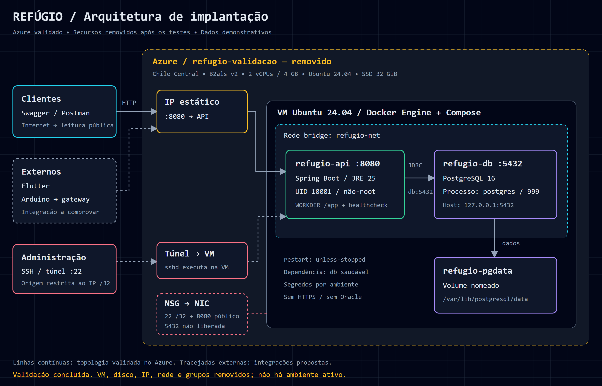
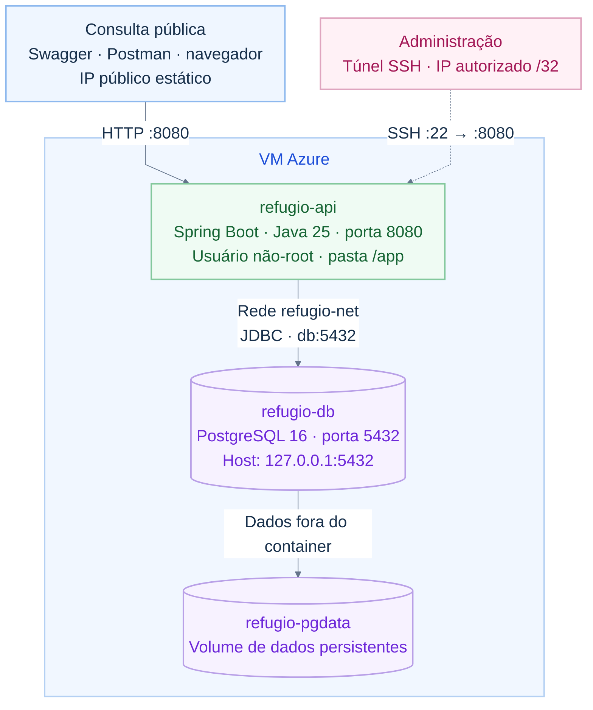
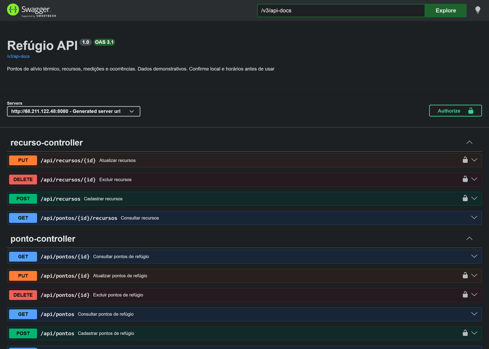

# Refúgio

Infraestrutura Docker e implantação no Azure para a API de pontos de alívio térmico.

## Equipe

| Integrante | RM | Turma |
| --- | --- | --- |
| Luis Fillipe Rodrigues Seripieri | 567918 | 2TDSPB |
| Gabriel Rocha de Souza | 567023 | 2TDSPB |
| Luiz Kichimoto Valdevino | 567726 | 2TDSPB |
| Guilherme Soares | 568227 | 2TDSPB |
| Gabriel Stuani | 566682 | 2TDSPB |

O Refúgio reúne informações sobre pontos de alívio térmico, seus endereços, horários e recursos, como água e sombra. A consulta é pública. Gestores mantêm os cadastros, e a API também registra medições ambientais e relatos de indisponibilidade.

O código da aplicação é mantido no [repositório Refúgio Java](https://github.com/Guilherme-Soares00/refugio). Este repositório cuida da infraestrutura: Dockerfile, Docker Compose, scripts Azure e evidências de execução. Durante o build, o Docker baixa o código diretamente do projeto Java e gera a imagem da API. Não há uma segunda cópia da aplicação para manter aqui.

Projeto de DevOps Tools & Cloud Computing da Global Solution FIAP 2026/2.

## Conteúdo

- [Execução local](#como-executar)
- [Uso da API](#usar-a-api)
- [Arquitetura](#arquitetura)
- [Operação e persistência](#operacao)
- [Implantação no Azure](#azure)
- [Testes](#testes)
- [Vídeo e evidências](#evidencias)
- [Solução de problemas](#problemas)
- [Estrutura do repositório](#sobre-o-repositorio)

<a id="como-executar"></a>

## Execução local

### Pré-requisitos

| Ferramenta | Quando é necessária |
| --- | --- |
| Docker Desktop com containers Linux, ou Docker Engine com Compose | Compilar e executar a API e o PostgreSQL. O Compose precisa aceitar `up --wait`. |
| Git | Para baixar o repositório. |
| Bash, OpenSSL e curl | Para preparar a configuração e conferir o serviço. No Windows, use o Git Bash. |

Para iniciar pelo Docker, não é necessário instalar Java, Maven ou PostgreSQL no computador. Node.js 22 ou superior é opcional, usado nos testes HTTP e exemplos de curl. JDK 25 só é necessário para executar a suíte Java fora dos containers.

No Windows, abra o Docker Desktop e aguarde a inicialização. O comando `docker version` precisa mostrar tanto o cliente quanto o servidor.

### Iniciar a aplicação

Execute no **Git Bash local, WSL ou terminal Linux**:

```bash
git clone https://github.com/Guilherme-Soares00/refugio-devops.git
cd refugio-devops
bash scripts/preparar-ambiente.sh --dados-demo
docker compose up -d --build --wait --wait-timeout 240
docker compose ps
curl -fsS http://localhost:8080/actuator/health
```

Na primeira execução, o Docker baixa o código Java, as imagens e as dependências do Maven. É necessário ter acesso à internet. Ao terminar, os serviços `api` e `db` devem aparecer como `healthy`, e a consulta de saúde deve responder:

```json
{"status":"UP"}
```

O script de preparação gera a senha do banco e a chave JWT no `.env`. Em um novo ambiente, `--dados-demo` habilita os registros de exemplo; sem essa opção, a carga fica desabilitada. Se o `.env` já existir, ele é mantido sem alterações.

Se você estiver no PowerShell, abra o Git Bash na pasta do projeto para executar o preparador. Depois disso, os comandos `docker compose` também podem ser usados no PowerShell.

### Abrir no navegador

| Endereço local | O que você encontra |
| --- | --- |
| [Swagger UI](http://localhost:8080/swagger-ui/index.html) | Documentação interativa para consultar e testar os endpoints. |
| [Catálogo de pontos](http://localhost:8080/api/pontos) | Resposta da consulta pública em JSON. |
| [Saúde da aplicação](http://localhost:8080/actuator/health) | Indicação de que o serviço está respondendo. |
| [Especificação OpenAPI](http://localhost:8080/v3/api-docs) | Descrição dos endpoints, entradas e respostas. |

A carga de exemplo termina após a inicialização da API. Se o login ainda não funcionar, aguarde alguns segundos antes de tentar novamente.

### Encerrar a aplicação

Na raiz do repositório:

```bash
docker compose down
```

Esse comando remove os containers e mantém os dados do banco. Não acrescente `-v`: essa opção também remove o volume de dados.

<details>
<summary>Como o build utiliza o repositório Java</summary>

O `Dockerfile` obtém o código de `Guilherme-Soares00/refugio`. O projeto Java mantém os fontes, o Maven Wrapper e os testes; o DevOps define como compilar e executar a aplicação com o banco.

A versão usada no build é o commit `c76af11aef2d871a130b4c3db1c22bd71dfe60dd`, definido em `ARG JAVA_REF`. Essa referência fixa permite reproduzir a mesma versão da API. Um novo commit no Java não atualiza a implantação automaticamente: para adotá-lo, altere `JAVA_REF` no Dockerfile e reconstrua a imagem com `docker compose up -d --build --wait --wait-timeout 240`.

A imagem final registra a origem e o commit Java nos rótulos `org.opencontainers.image.source` e `org.opencontainers.image.revision`.

</details>

<a id="usar-a-api"></a>

## Uso da API

### Consultas e autenticação

A consulta do catálogo não exige login. Para cadastrar, alterar ou excluir pontos e recursos, use uma conta com o perfil `GESTOR`.

Com `--dados-demo`, a aplicação carrega registros fictícios e as contas abaixo. Elas são públicas e devem ser usadas apenas para testes:

| Perfil | E-mail | Senha de demonstração |
| --- | --- | --- |
| GESTOR | gestor09@example.test | GestorDemo2026! |
| CIDADAO | cidadao01@example.test | CidadaoDemo2026! |

1. Abra o Swagger e execute `POST /api/auth/login` com o e-mail e a senha do gestor.
2. Copie o valor de `accessToken` retornado.
3. Clique em **Authorize** e informe o token. O esquema Bearer do Swagger acrescenta o prefixo necessário.
4. Use os endpoints de pontos e recursos para criar, consultar, atualizar e excluir um cadastro de teste.

O token JWT identifica o usuário e seu perfil de acesso. O cadastro público cria contas `CIDADAO`, sem permissão para administrar pontos e recursos. Uma operação protegida sem autenticação retorna `401`; com um perfil sem permissão, retorna `403`.

Não use essas contas em ambientes com dados reais nem exponha tokens em capturas ou gravações. Os dados iniciais não confirmam a disponibilidade real dos locais; confira endereços e horários antes de utilizá-los.

### Testar o CRUD

Com Node.js instalado, execute no **terminal local**, na raiz do projeto:

```bash
node scripts/testar-api.mjs http://localhost:8080 crud
```

O teste executa 27 verificações de autenticação, permissões, criação, consulta, atualização e exclusão de pontos e recursos. Também confere erros, OpenAPI e saúde da aplicação. O resultado esperado é `APROVADO`.

Esse teste usa o código `REF-989` e exclui seus registros ao terminar. Não o execute se esse código já identificar um cadastro importante. Se houver uma falha no meio do processo, confira e remova somente os registros criados pelo teste, sem apagar o volume do banco.

<details>
<summary>Executar o CRUD por curl</summary>

Requer Bash, curl e Node.js. Execute no **terminal local**, na raiz do projeto, com o código `REF-988` disponível. As variáveis guardam o token e os identificadores retornados pela API; não ative `set -x` nem imprima o token.

```bash
BASE=http://localhost:8080
TOKEN=$(curl -fsS -X POST "$BASE/api/auth/login" -H 'Content-Type: application/json' --data '{"email":"gestor09@example.test","senha":"GestorDemo2026!"}' | node -e 'let d="";process.stdin.on("data",c=>d+=c);process.stdin.on("end",()=>process.stdout.write(JSON.parse(d).accessToken))')
PONTO=$(curl -fsS -X POST "$BASE/api/pontos" -H 'Content-Type: application/json' -H "Authorization: Bearer $TOKEN" --data '{"codigoPublico":"REF-988","nome":"Ponto manual DevOps","logradouro":"Rua Demonstrativa","numero":"100","bairro":"Bairro DevOps","cidade":"Cidade Demonstrativa","uf":"SP","horarioTexto":"08:00-18:00","status":"ATIVO"}')
PONTO_ID=$(printf '%s' "$PONTO" | node -e 'let d="";process.stdin.on("data",c=>d+=c);process.stdin.on("end",()=>process.stdout.write(String(JSON.parse(d).id)))')
curl -fsS "$BASE/api/pontos/$PONTO_ID"
RECURSO=$(curl -fsS -X POST "$BASE/api/recursos" -H 'Content-Type: application/json' -H "Authorization: Bearer $TOKEN" --data "{\"pontoId\":$PONTO_ID,\"tipo\":\"AGUA\",\"disponivel\":true}")
RECURSO_ID=$(printf '%s' "$RECURSO" | node -e 'let d="";process.stdin.on("data",c=>d+=c);process.stdin.on("end",()=>process.stdout.write(String(JSON.parse(d).id)))')
curl -fsS "$BASE/api/pontos/$PONTO_ID/recursos"
curl -sS -w '%{http_code}\n' -X PUT "$BASE/api/pontos/$PONTO_ID" -H 'Content-Type: application/json' -H "Authorization: Bearer $TOKEN" --data '{"nome":"Ponto manual atualizado","logradouro":"Rua Demonstrativa","numero":"100","bairro":"Bairro DevOps","cidade":"Cidade Demonstrativa","uf":"SP","horarioTexto":"09:00-17:00","status":"ATIVO"}'
curl -sS -w '%{http_code}\n' -X PUT "$BASE/api/recursos/$RECURSO_ID" -H 'Content-Type: application/json' -H "Authorization: Bearer $TOKEN" --data "{\"pontoId\":$PONTO_ID,\"tipo\":\"AGUA\",\"disponivel\":false}"
curl -fsS "$BASE/api/pontos/$PONTO_ID/recursos"
curl -sS -w '%{http_code}\n' -X DELETE "$BASE/api/recursos/$RECURSO_ID" -H "Authorization: Bearer $TOKEN"
curl -sS -w '%{http_code}\n' -X DELETE "$BASE/api/pontos/$PONTO_ID" -H "Authorization: Bearer $TOKEN"
unset TOKEN
```

A criação retorna `201`; as consultas, `200`; e as alterações e exclusões, `204`. O código público de um ponto não muda após o cadastro. Exclua primeiro os recursos do seu teste: um ponto com relacionamentos não pode ser removido livremente. Pontos com histórico de medições ou ocorrências devem ser inativados.

</details>

<a id="arquitetura"></a>

## Arquitetura

A API e o PostgreSQL executam em containers separados, conectados pela rede do Compose. O banco grava os dados em um volume nomeado, preservado quando os containers são recriados.

| Componente | Função neste projeto |
| --- | --- |
| `refugio-api` | API Spring Boot com Java 25, publicada na porta `8080`. A JVM roda sem privilégios de administrador. |
| `refugio-db` | PostgreSQL 16. A porta `5432` fica acessível somente pelo próprio computador ou pela VM. |
| `refugio-net` | Rede privada do Compose. A API encontra o banco pelo nome do serviço `db`. |
| `refugio-pgdata` | Volume nomeado que mantém os dados quando os containers são recriados. |
| VM Azure | Máquina Ubuntu 24.04 LTS x64 usada para executar o mesmo Compose na nuvem. |



[Abrir o diagrama em tamanho original](docs/devops/arquitetura.png).

O diagrama representa a arquitetura usada na implantação Azure, já encerrada. Flutter e Arduino aparecem como integrações propostas, não validadas neste repositório. O banco deste ambiente é PostgreSQL; Oracle não participa da implantação.

Na nuvem, o NSG funciona como um filtro de rede associado à interface da VM: permite SSH na porta `22` a partir do IP administrativo e acesso à API na porta `8080`. Não há liberação pública da porta `5432`. No computador, a API é publicada em `127.0.0.1`, acessível apenas localmente.

O Compose usa nomes fixos para containers, rede e volume. Não inicie outra cópia com os mesmos nomes no mesmo computador ou VM.

<details>
<summary>Outros formatos e visão simplificada em Mermaid</summary>

O diagrama também está disponível em [HTML](docs/devops/arquitetura.html), [SVG](docs/devops/arquitetura.svg) e [PNG](docs/devops/arquitetura.png). Para gerar um PDF, abra o HTML no navegador, use **Imprimir → Salvar como PDF**, escolha paisagem e habilite os gráficos de fundo.

A imagem principal mostra a implantação completa. O Mermaid abaixo resume a comunicação entre os containers e os acessos. A VM da validação já foi removida.



</details>

<details>
<summary>Entender as etapas do Dockerfile</summary>

O Dockerfile usa duas etapas: obtém o código diretamente do repositório Java e o compila com JDK e Maven; depois copia somente o JAR para a imagem final, que contém o ambiente de execução Java. Isso evita duplicar o código da API no DevOps e levar ferramentas de compilação para o container em execução.

| Instrução | Para que serve |
| --- | --- |
| `ARG JAVA_REF` | Fixa o commit do repositório Java que será compilado. |
| `FROM eclipse-temurin:25-jdk-jammy AS build` | Define o Java usado na compilação. |
| `WORKDIR /build` | Organiza os arquivos da etapa de compilação. |
| `ADD https://github.com/Guilherme-Soares00/refugio.git#${JAVA_REF}` | Obtém o código e o Maven Wrapper diretamente do commit Java selecionado. |
| `RUN --mount=type=cache ... package` | Reaproveita os downloads do Maven entre builds. |
| `-Dmaven.test.skip=true` | Separa a construção da imagem dos testes que precisam de um banco descartável. |
| `FROM eclipse-temurin:25-jre-jammy` | Usa um ambiente de execução Java, sem o JDK da compilação. |
| `LABEL org.opencontainers.image.source` e `revision` | Identificam a origem e a revisão Java da imagem. |
| `WORKDIR /app` | Define a pasta de trabalho da API. |
| Instalação de `curl` | Disponibiliza a ferramenta usada pelo healthcheck. |
| `groupadd`, `useradd` e `USER 10001:10001` | Executam a JVM com um usuário Linux não-root. |
| `ENV` | Define os padrões de porta e memória, sem incluir segredos. |
| `COPY --from=build --chown` | Copia o JAR para a imagem final com o proprietário adequado. |
| `EXPOSE 8080` | Documenta a porta; quem a publica no computador é o Compose. |
| `ENTRYPOINT` em array | Inicia o Java diretamente e permite que receba os sinais de parada. |

A `.dockerignore` mantém Git, segredos, testes de infraestrutura e outros arquivos locais desnecessários fora do contexto de build. Ela não filtra o repositório Java obtido pelo `ADD`; esse código fica na etapa de compilação e somente o JAR é copiado para a imagem final.

</details>

<a id="operacao"></a>

## Operação e persistência

Execute os comandos desta seção na **raiz do repositório**, no computador ou em uma sessão SSH dentro da VM. No ambiente remoto, entre primeiro em `$HOME/refugio-devops`.

### Ver serviços e logs

```bash
docker compose ps
docker compose logs --tail 60 api
docker compose logs --tail 60 db
```

Os logs da API e do banco são enviados à saída dos processos e consultados separadamente pelos nomes `api` e `db`. O PostgreSQL deve indicar `database system is ready to accept connections` ao terminar a inicialização.

<details>
<summary>Conferir usuários, diretórios e dados do banco</summary>

```bash
docker compose exec -T api sh -c 'whoami; id; pwd; ls -la /app'
docker compose exec -T api sh -c 'printf "SERVER_PORT=%s\n" "$SERVER_PORT"; printf "SPRING_DATASOURCE_URL=%s\n" "$SPRING_DATASOURCE_URL"'
docker compose exec -T db sh -c 'id postgres; pwd; ls -ld /var/lib/postgresql/data'
docker compose exec -T --user postgres db id
docker compose exec -T db sh -c 'printf "POSTGRES_DB=%s\nPOSTGRES_USER=%s\n" "$POSTGRES_DB" "$POSTGRES_USER"'
docker compose top db
```

A API usa o usuário Linux `refugio`, UID/GID `10001`, e o diretório `/app`. Ela não mantém os cadastros em seu próprio sistema de arquivos.

No banco, o servidor PostgreSQL roda como `postgres`. Um `docker compose exec db whoami` sem `--user` pode mostrar `root`, pois informa o usuário daquele comando, não o do servidor já em execução. Confira o processo com `top db`. O UID observado na imagem testada foi `999`, mas pode variar entre imagens.

`refugio_app` é o usuário SQL do banco, diferente do usuário Linux `postgres`. A imagem oficial cria essa conta inicial com privilégios elevados; esta configuração não representa uma política de menor privilégio SQL para produção.

### Consultar as duas tabelas relacionadas

```bash
docker compose exec -T db psql -U refugio_app -d refugio -v ON_ERROR_STOP=1 -c "SELECT p.codigo_publico,p.nome,r.tipo,r.disponivel FROM ponto_refugio p JOIN recurso_ponto r ON r.ponto_id=p.id ORDER BY p.codigo_publico,r.tipo;"
docker volume inspect refugio-pgdata --format '{{.Name}} {{.Driver}}'
docker network inspect refugio-net --format '{{.Name}} {{.Driver}}'
```

O SELECT é executado diretamente no PostgreSQL. Cada recurso se relaciona com um ponto por `recurso_ponto.ponto_id → ponto_refugio.id`. Os dados ficam em `/var/lib/postgresql/data`, ligado ao volume `refugio-pgdata`.

</details>

### Conferir a persistência

O procedimento cria o ponto `REF-990` e um recurso `AGUA`, guarda os identificadores e confere se continuam iguais após a recriação dos containers.

> [!WARNING]
> `docker compose down` interrompe os serviços, mas mantém o volume. Não acrescente `-v`: essa opção também remove o volume e apaga os dados.

Com Node.js instalado, execute no **terminal local**, na raiz do projeto:

```bash
node scripts/testar-api.mjs http://localhost:8080 preparar-persistencia
docker compose exec -T db psql -U refugio_app -d refugio -c "SELECT p.id,p.codigo_publico,r.id AS recurso_id,r.tipo FROM ponto_refugio p JOIN recurso_ponto r ON r.ponto_id=p.id WHERE p.codigo_publico='REF-990';"
docker compose down
docker compose up -d --wait --wait-timeout 240
node scripts/testar-api.mjs http://localhost:8080 verificar-persistencia
docker compose exec -T db psql -U refugio_app -d refugio -c "SELECT p.id,p.codigo_publico,r.id AS recurso_id,r.tipo FROM ponto_refugio p JOIN recurso_ponto r ON r.ponto_id=p.id WHERE p.codigo_publico='REF-990';"
```

Execute o preparo uma única vez. Se `REF-990` já existir, use a verificação, sem tentar recriá-lo. O estado do teste fica em `target/devops/persistencia.json`, fora do Git, e deve ser usado com a mesma URL do preparo. O teste preserva esse cadastro para novas conferências.

A carga inicial usa identificadores próprios para não duplicar dados em reinícios sequenciais. Ela não sobrescreve alterações, mas pode recriar um exemplo que tenha sido removido. Para testar exclusões, use códigos fora de `REF-001` a `REF-010`. Não inicie duas APIs com a carga de exemplo em paralelo sobre esse banco.

<details>
<summary>Consultar as variáveis de ambiente</summary>

O arquivo `.env.example` mostra os campos disponíveis. O preparador preenche os segredos do `.env` local, que não deve ser versionado. O Compose lê esse arquivo e envia a cada container as variáveis declaradas em `environment`.

| Variável | Valor padrão ou finalidade |
| --- | --- |
| `POSTGRES_DB` | `refugio`, o banco inicial. |
| `POSTGRES_USER` | `refugio_app`, a conta de inicialização do banco. |
| `POSTGRES_PASSWORD` | Obrigatória; o preparador gera 24 bytes aleatórios em hexadecimal. |
| `POSTGRES_PORT` | `5432`, publicada somente em `127.0.0.1`. |
| `SPRING_DATASOURCE_URL` | `jdbc:postgresql://db:5432/refugio`; `db` é o nome do serviço na rede do Compose. |
| `SPRING_DATASOURCE_USERNAME` e `SPRING_DATASOURCE_PASSWORD` | Recebidas pela API a partir de `POSTGRES_USER` e `POSTGRES_PASSWORD`. |
| `SPRING_JPA_HIBERNATE_DDL_AUTO` | `update`, para criação e ajuste acadêmico das tabelas. |
| `JWT_SECRET` | Base64 com pelo menos 32 bytes decodificados; o preparador gera 48 bytes. |
| `JWT_EXPIRATION_SECONDS` | `3600`, a duração do token em segundos. |
| `CORS_ALLOWED_ORIGINS` | `http://localhost:3000`; ajuste à origem real de um cliente web. |
| `APP_SEED_ENABLED` | `false`; o preparador usa `true` com `--dados-demo`. |
| `API_BIND_ADDRESS` | `127.0.0.1` no computador; `0.0.0.0` com `--publicar-api`, para a VM. |
| `API_PORT` | `8080`, a porta publicada no host. |
| `JAVA_TOOL_OPTIONS` | `-XX:MaxRAMPercentage=65.0 -XX:+ExitOnOutOfMemoryError`. |
| `SERVER_PORT` | `8080` dentro da API; esse mapeamento interno é fixo no Compose. |

A configuração do banco é compartilhada por referência no Compose para evitar senhas divergentes entre os serviços. Se mudar `POSTGRES_DB`, ajuste também a URL JDBC. Dentro de um container, `localhost` aponta para ele próprio, não para o banco em outro container.

Mudar `POSTGRES_PASSWORD` no `.env` não altera a senha de um banco já inicializado no volume. Nesse caso, altere a senha no PostgreSQL, sincronize a configuração e recrie a API. Não apague o volume como forma de corrigir a conexão.

O Java iniciado fora do Compose não lê `.env` automaticamente. A opção JPA `update` também não substitui migrações versionadas para um ambiente de produção.

</details>

Não publique `.env`, chaves privadas ou tokens. Para conferir a configuração sem expor os valores, use `docker compose config --quiet`. Evite `printenv`, `docker inspect` e `docker compose config` completos em capturas, pois podem mostrar senhas.

<a id="azure"></a>

## Implantação no Azure

A implantação usa uma VM Ubuntu 24.04 com Docker e os mesmos serviços do ambiente local. Os scripts separam a criação da infraestrutura, a instalação do Docker e o deploy. Não há uma VM de demonstração mantida online.

**O Azure pode consumir créditos.** Antes de criar o ambiente, confira a assinatura, a região, a quota e os preços de VM, disco e IP. Desalocar a VM não elimina os custos de todos os recursos. Leia também a etapa de limpeza.

Por padrão, os scripts usam `--plano`, que apenas descreve a operação. Para executar, é necessário informar `--executar` e as confirmações indicadas em cada etapa. Login e chave SSH são preparados separadamente; uma falha não remove recursos automaticamente.

<details>
<summary>Passo a passo: provisionamento, deploy e limpeza</summary>

### 1. Preparar a conta e os parâmetros

No **Git Bash local, WSL ou Azure Cloud Shell**, com Azure CLI instalada:

```bash
az login --use-device-code
az account list --query '[].{nome:name,id:id,estado:state}' --output table
```

Se a sessão já estiver autenticada, não repita o login. Use uma assinatura em que você tenha permissão para provisionar os recursos.

Na **raiz do repositório, no terminal local**, substitua o UUID, o IP administrativo e o caminho da sua chave pública existente:

```bash
export AZURE_SUBSCRIPTION_ID='SUBSTITUA-PELO-UUID-AUTORIZADO'
export RESOURCE_GROUP=refugio-devops
export LOCATION=chilecentral
export VM_SIZE=Standard_B2als_v2
export VM_NAME=refugio-vm
export ADMIN_USER=refugioadmin
export ADMIN_CIDR='SEU-IPV4-PUBLICO/32'
export SSH_PUBLIC_KEY="$HOME/.ssh/sua-chave-existente.pub"
bash azure/01-provisionar.sh --plano
```

| Parâmetro | O que conferir |
| --- | --- |
| `AZURE_SUBSCRIPTION_ID` | UUID da assinatura escolhida. Não é o nome da assinatura. |
| `RESOURCE_GROUP` e `VM_NAME` | Nomes iniciados por `refugio-`. O grupo deve ser novo e exclusivo deste projeto. |
| `LOCATION` | `chilecentral` foi a região validada; confirme se sua assinatura permite usá-la. |
| `VM_SIZE` | `Standard_B2als_v2`, com 2 vCPUs e 4 GB, foi o tamanho validado. Confira quota, capacidade e preço. |
| `ADMIN_CIDR` | Seu IPv4 público com `/32`, para restringir o SSH a esse endereço. |
| `SSH_PUBLIC_KEY` | Caminho de um arquivo `.pub` existente. A chave privada fica somente no seu computador. |

No Windows, o caminho da chave pode estar no formato `C:/Users/seu-usuario/.ssh/chave.pub` ou em um caminho válido no Git Bash. O script converte o caminho para a Azure CLI nativa sem alterar a chave.

Os padrões estão em `azure/_comum.sh`. A imagem padrão é `Canonical:ubuntu-24_04-lts:server:latest`; o disco usa `StandardSSD_LRS`. O script aceita também `Standard_LRS`, mas não muda região ou tamanho por conta própria se houver um erro.

Antes da criação, consulte no **terminal local**:

```bash
az account show --subscription "$AZURE_SUBSCRIPTION_ID" --query '{nome:name,estado:state}' --output table
az account list-locations --subscription "$AZURE_SUBSCRIPTION_ID" --query '[].{regiao:name,nome:displayName}' --output table
az vm list-skus --subscription "$AZURE_SUBSCRIPTION_ID" --location "$LOCATION" --size "$VM_SIZE" --resource-type virtualMachines --all --output table
az vm list-usage --subscription "$AZURE_SUBSCRIPTION_ID" --location "$LOCATION" --output table
```

Um SKU listado não garante capacidade de alocação. Se a assinatura bloquear a opção escolhida, revise os parâmetros antes de tentar novamente. Os providers `Microsoft.Compute` e `Microsoft.Network` precisam estar registrados; o provisionador verifica isso, mas não os registra automaticamente.

Confira os preços de [VM Linux](https://azure.microsoft.com/pricing/details/virtual-machines/linux/), [discos gerenciados](https://azure.microsoft.com/pricing/details/managed-disks/) e [IP público](https://azure.microsoft.com/pricing/details/ip-addresses/) para a configuração escolhida.

### 2. Criar a VM

Somente após aceitar os custos, execute no **terminal local**, na raiz do repositório:

```bash
AUTORIZAR_CUSTOS=SIM CONFIRMAR_CRIACAO="CRIAR:$RESOURCE_GROUP" \
  bash azure/01-provisionar.sh --executar
```

O script cria o grupo, a rede, o NSG, o IP público estático, a interface de rede e a VM com disco de 32 GiB. O SSH fica restrito a `ADMIN_CIDR`; a API usa a porta `8080`; o PostgreSQL não recebe regra pública. O Docker será instalado na próxima etapa.

Se a criação falhar depois de iniciar, podem restar recursos cobrados. Confira o grupo antes de repetir e siga o procedimento de [limpeza](#limpeza-azure) quando a exclusão for autorizada.

### 3. Conectar à VM e instalar Docker

No **terminal local**, obtenha o IP real e informe a chave privada correspondente à chave pública usada na criação:

```bash
export PUBLIC_IP="$(az network public-ip show --subscription "$AZURE_SUBSCRIPTION_ID" --resource-group "$RESOURCE_GROUP" --name refugio-ip --query ipAddress --output tsv)"
export SSH_PRIVATE_KEY="$HOME/.ssh/sua-chave-existente"
export DESTINO_SSH="$ADMIN_USER@$PUBLIC_IP"
az vm run-command invoke --subscription "$AZURE_SUBSCRIPTION_ID" --resource-group "$RESOURCE_GROUP" --name "$VM_NAME" --command-id RunShellScript --scripts 'ssh-keygen -l -E sha256 -f /etc/ssh/ssh_host_ed25519_key.pub' --query 'value[0].message' --output tsv
```

O último comando obtém a impressão digital da chave pública do servidor pelo canal autenticado do Azure. Compare o valor ED25519 com o mostrado na primeira conexão SSH antes de responder `yes`. Se a VM for recriada, confira a identidade novamente; não desative essa verificação.

Ainda no **terminal local**, crie a pasta remota, transfira os scripts e conecte:

```bash
ssh -i "$SSH_PRIVATE_KEY" "$DESTINO_SSH" 'mkdir -p "$HOME/azure-refugio"'
scp -i "$SSH_PRIVATE_KEY" azure/_comum.sh azure/02-instalar-docker.sh azure/03-deploy.sh "$DESTINO_SSH:azure-refugio/"
ssh -i "$SSH_PRIVATE_KEY" "$DESTINO_SSH"
```

Agora, na **sessão remota Ubuntu**, instale o Docker:

```bash
cd "$HOME/azure-refugio"
bash 02-instalar-docker.sh --plano
sudo env AUTORIZAR_ALTERACAO_LOCAL=SIM CONFIRMAR_DOCKER=INSTALAR-DOCKER-NA-VM DOCKER_USER="$(id -un)" \
  bash 02-instalar-docker.sh --executar
exit
```

O instalador usa o repositório oficial do Docker, instala Engine, Buildx e o plugin Compose e habilita o serviço no boot. Também instala Git, curl e OpenSSL. Ele exige Ubuntu 24.04 LTS amd64 e um usuário Linux não-root.

O grupo `docker` concede acesso administrativo ao Docker. A nova associação só entra na sessão depois que você se reconecta. No **terminal local**:

```bash
ssh -i "$SSH_PRIVATE_KEY" "$DESTINO_SSH"
```

### 4. Publicar a aplicação na VM

Na **sessão remota Ubuntu**, com seu usuário no grupo Docker:

```bash
cd "$HOME/azure-refugio"
bash 03-deploy.sh --plano
AUTORIZAR_ALTERACAO_LOCAL=SIM CONFIRMAR_DEPLOY=DEPLOY-REFUGIO-NA-VM \
  bash 03-deploy.sh --executar
```

O deploy clona este repositório em `$HOME/refugio-devops`, prepara o `.env` com dados de demonstração e inicia o Compose em segundo plano. Se a pasta já existir, só aceita a origem esperada, a branch `main` e um checkout sem alterações; a atualização usa `--ff-only`.

Um `.env` existente precisa ser um arquivo regular com permissão `600`. O script preserva seu conteúdo e verifica que não foi alterado. Na VM, a API é publicada em `0.0.0.0:8080`; a porta do banco continua restrita a `127.0.0.1:5432`.

Depois do deploy, confira na **sessão remota**:

```bash
cd "$HOME/refugio-devops"
docker --version
docker compose version
docker compose ps
```

No **computador local**, consulte a API pelo IP público:

```bash
curl -fsS "http://$PUBLIC_IP:8080/actuator/health"
curl -fsS "http://$PUBLIC_IP:8080/api/pontos"
```

Abra também `http://IP_PUBLICO_DA_VM:8080/swagger-ui/index.html`, substituindo o endereço. Uma consulta feita somente dentro da VM não comprova o acesso externo.

### 5. Proteger o acesso administrativo

Esta demonstração não possui HTTPS. Para login e operações com token, abra um túnel SSH em um **segundo terminal local**:

```bash
ssh -i "$SSH_PRIVATE_KEY" -N -L 127.0.0.1:18080:127.0.0.1:8080 "$DESTINO_SSH"
```

Mantenha esse terminal aberto. Acesse o Swagger por `http://127.0.0.1:18080/swagger-ui/index.html` ou, em outro **terminal local**, execute:

```bash
node scripts/testar-api.mjs http://localhost:18080 crud
```

A aplicação continua na VM; o túnel protege o transporte das credenciais. As contas demonstrativas ainda são públicas, portanto esse ambiente não é adequado para informações reais.

### 6. Conferir persistência e reinício

Use o mesmo procedimento de [persistência](#operacao), com duas diferenças: os comandos Node rodam no **computador local**, com a URL `http://localhost:18080`, e os comandos Docker e SELECT rodam na **sessão SSH**, em `$HOME/refugio-devops`. Use a mesma URL no preparo e na verificação. O instalador da VM não instala Node.js.

Para conferir o retorno automático depois de um reboot, deixe os containers em execução e, após autorizar o reinício, execute no **terminal local autenticado no Azure**:

```bash
az vm restart --subscription "$AZURE_SUBSCRIPTION_ID" --resource-group "$RESOURCE_GROUP" --name "$VM_NAME"
az vm get-instance-view --subscription "$AZURE_SUBSCRIPTION_ID" --resource-group "$RESOURCE_GROUP" --name "$VM_NAME" --query 'instanceView.statuses[].displayStatus' --output table
```

Aguarde a VM retornar e reconecte. Na **sessão remota**:

```bash
cd "$HOME/refugio-devops"
systemctl is-enabled docker
docker compose ps
docker compose exec -T db psql -U refugio_app -d refugio -c "SELECT p.codigo_publico,r.tipo FROM ponto_refugio p JOIN recurso_ponto r ON r.ponto_id=p.id WHERE p.codigo_publico='REF-990';"
```

Reabra o túnel e repita a verificação de persistência e as consultas públicas. O Docker deve estar habilitado e os dois containers devem voltar a ficar `healthy` sem um novo `compose up`. A política `unless-stopped` não reinicia containers deixados deliberadamente parados; depois de `compose down`, é necessário executar `compose up`.

<a id="limpeza-azure"></a>

### 7. Parar, iniciar e remover o ambiente

Execute estes comandos no **terminal local**, na raiz do repositório, com os mesmos parâmetros da criação.

Para apenas revisar as operações, sem chamadas Azure:

```bash
bash azure/parar-iniciar.sh parar --plano
bash azure/parar-iniciar.sh iniciar --plano
bash azure/limpar.sh --plano "$RESOURCE_GROUP"
```

Para desalocar a VM, após autorizar a parada:

```bash
AUTORIZAR_ALTERACAO_AZURE=SIM CONFIRMAR_PARADA="PARAR:$RESOURCE_GROUP:$VM_NAME" \
  bash azure/parar-iniciar.sh parar --executar
```

A desalocação interrompe a computação, mas mantém os dados, o disco e o IP estático. Disco e IP podem continuar gerando custos. Para iniciar novamente, após aceitar a cobrança de computação:

```bash
AUTORIZAR_CUSTOS=SIM CONFIRMAR_INICIO="INICIAR:$RESOURCE_GROUP:$VM_NAME" \
  bash azure/parar-iniciar.sh iniciar --executar
```

**A exclusão abaixo é irreversível:** remove o grupo inteiro, incluindo a VM, o disco e os dados do volume PostgreSQL. Use somente quando não precisar mais desse ambiente e a remoção estiver autorizada:

```bash
AUTORIZAR_EXCLUSAO=SIM CONFIRMAR_EXCLUSAO="EXCLUIR:$RESOURCE_GROUP" \
  bash azure/limpar.sh --executar "$RESOURCE_GROUP"
```

O script valida a identificação do grupo, aguarda a exclusão e confirma a ausência de recursos daquele grupo. Não basta excluir somente a VM, pois o IP público e outros recursos podem permanecer.

O Azure pode criar um `NetworkWatcherRG` fora do grupo do projeto. Não remova grupos preexistentes ou compartilhados. Após a limpeza, confira no **terminal local**:

```bash
az group list --subscription "$AZURE_SUBSCRIPTION_ID" --query '[].{nome:name,regiao:location}' --output table
az resource list --subscription "$AZURE_SUBSCRIPTION_ID" --query '[].{nome:name,tipo:type,grupo:resourceGroup}' --output table
```

Na validação registrada, o grupo automático não existia antes da sessão e continha somente o watcher criado para o teste. Sua exclusão também foi autorizada e confirmada. Em outra assinatura, avalie esse grupo antes de qualquer remoção.

</details>

<a id="testes"></a>

## Testes

Os testes de infraestrutura ficam neste repositório. A suíte Java pertence ao repositório da API, e os testes HTTP precisam da aplicação em execução.

No **terminal local**, na raiz do repositório, você pode validar Compose, geração de ambiente e proteções dos scripts sem criar recursos Azure:

```bash
node --test tests/compose.test.mjs tests/environment.test.mjs tests/api-safety.test.mjs tests/source.test.mjs
bash tests/test-azure.sh
```

Os quatro testes Node conferem Compose, preparação do ambiente, proteção das credenciais e origem do código Java. As 57 verificações Bash usam respostas simuladas para validar as proteções dos scripts Azure; não criam recursos nem comprovam um deploy na nuvem. Para testar a aplicação em execução, use o [teste de CRUD](#usar-a-api).

<details>
<summary>Executar a suíte Java com um PostgreSQL descartável</summary>

Os testes Java pertencem ao repositório da API. Requerem JDK 25 no computador, recriam tabelas e só aceitam o banco `refugio_test`. Nunca aponte os testes para o banco principal ou uma base compartilhada.

No **Git Bash local**, a partir da raiz do DevOps, faça um checkout separado da mesma revisão Java usada pelo Dockerfile. A pasta de destino deve estar disponível:

```bash
git clone https://github.com/Guilherme-Soares00/refugio.git ../refugio-java-testes
git -C ../refugio-java-testes checkout --detach c76af11aef2d871a130b4c3db1c22bd71dfe60dd
```

No **terminal local**:

```bash
docker run --name refugio-devops-test --rm -d -p 127.0.0.1:55432:5432 -e POSTGRES_DB=refugio_test -e POSTGRES_USER=refugio_test -e POSTGRES_PASSWORD=refugio_test_only postgres:16
docker exec refugio-devops-test pg_isready -U refugio_test -d refugio_test
```

Aguarde `accepting connections`. Se o container já existir, confira seu estado em vez de criá-lo novamente. As credenciais acima pertencem somente a esse banco descartável.

No **PowerShell local**, abra a pasta `refugio-java-testes` criada acima e execute:

```powershell
.\mvnw.cmd -B verify
```

Em Linux ou WSL com JDK 25, execute `bash mvnw -B verify` na pasta `refugio-java-testes`. Os relatórios ficam em `target/surefire-reports` desse checkout Java, não no repositório DevOps. Ao terminar, execute no **terminal local**:

```bash
docker stop refugio-devops-test
```

Esse comando remove o container descartável e seu banco de testes por causa de `--rm`. Ele não altera o volume principal do Refúgio.

</details>

<a id="evidencias"></a>

## Vídeo e evidências

[Assistir ao vídeo demonstrativo no YouTube](https://youtu.be/b66LBdZJXRA).

O vídeo registra a execução da API e do banco em uma VM Azure. Ao final, os recursos criados para a demonstração foram removidos. Os endereços das capturas pertencem a essa sessão encerrada.

O vídeo foi gravado antes da integração direta com o repositório Java. O build atual foi validado localmente: 103 testes Java, 39 verificações HTTP, Swagger com 17 operações e persistência após recriação e reinício dos containers. Os 67 arquivos usados na compilação também foram comparados com a revisão publicada. Essa rodada não incluiu uma nova implantação Azure.

<details>
<summary>Resultados registrados na execução Azure</summary>

| Verificação | Resultado registrado |
| --- | --- |
| Infraestrutura Azure | Ubuntu 24.04 LTS x64, Chile Central, `Standard_B2als_v2`, 2 vCPUs, 4 GB e disco SSD Standard de 32 GiB. |
| Instalação na VM | Docker 29.9.3 e Compose 5.7.1 instalados pelo script. |
| API e banco | Ambos saudáveis; API na porta `8080` e banco restrito ao loopback do host. |
| Acesso externo e Swagger | Saúde e catálogo acessados do computador; 17 operações carregadas no navegador. |
| CRUD e permissões | 27 verificações HTTP aprovadas na aplicação remota, com autenticação pelo túnel SSH. |
| Persistência | `REF-990`, ponto ID 13 e recurso ID 22 mantidos após recriação dos containers e reboot da VM. |
| Carga inicial | Mesmos totais antes e depois: 10 usuários, 11 pontos, 21 recursos, 10 medições e 10 ocorrências. |
| Reinício | Docker habilitado no boot e containers saudáveis com `unless-stopped`, sem um novo `compose up`. |
| Limpeza | Grupo do projeto e grupo automático removidos; inventário final vazio. |

As contagens incluem o ponto e o recurso criados para a persistência. A carga original tem 10 pontos e 20 recursos. Os IDs são resultados daquela execução, não números que outra instalação precise repetir.

</details>

<details>
<summary>Abrir as capturas e os registros técnicos</summary>



O IP visível na captura pertence à sessão encerrada e não é um endereço ativo de demonstração.

| Registro | Arquivo |
| --- | --- |
| Resumo da sessão | [azure-resumo.json](docs/devops/evidencias/azure-resumo.json) |
| Consulta final de limpeza | [azure-limpeza.json](docs/devops/evidencias/azure-limpeza.json) |
| Requisições do CRUD | [azure-crud.json](docs/devops/evidencias/azure-crud.json) |
| Infraestrutura e regras de rede | [azure-infraestrutura.json](docs/devops/evidencias/azure-infraestrutura.json) |
| SELECT antes da recriação | [azure-select-antes.txt](docs/devops/evidencias/azure-select-antes.txt) |
| SELECT depois da recriação | [azure-select-apos-recriacao.txt](docs/devops/evidencias/azure-select-apos-recriacao.txt) |
| SELECT depois do reboot | [azure-select-apos-reboot.txt](docs/devops/evidencias/azure-select-apos-reboot.txt) |
| Verificação HTTP após recriação | [azure-persistencia-recriacao.json](docs/devops/evidencias/azure-persistencia-recriacao.json) |
| Verificação HTTP após reboot | [azure-persistencia-reboot.json](docs/devops/evidencias/azure-persistencia-reboot.json) |
| Retorno dos serviços | [azure-reboot.txt](docs/devops/evidencias/azure-reboot.txt) |
| Trechos dos logs | [azure-logs.txt](docs/devops/evidencias/azure-logs.txt) |
| Consulta no ambiente local | [swagger-local-get-200.png](docs/devops/evidencias/swagger-local-get-200.png) |

Os três arquivos de SELECT são idênticos. O IP administrativo foi omitido dos registros de infraestrutura. Os arquivos públicos não incluem a senha real do banco, a chave JWT nem a chave SSH privada.

Os registros desta seção são históricos. Na validação local anterior à integração direta, foram executados 104 testes Java, três testes Node e 57 verificações Bash. O instalador teve seu fluxo simulado em Ubuntu 24.04 antes da instalação real na VM. Os resultados do build atual estão descritos acima.

</details>

<details>
<summary>Consultar a referência de custo da sessão encerrada</summary>

As tarifas públicas consultadas naquela sessão foram US$ 0,0526/h para a VM Linux, US$ 0,005/h para o IP Standard e US$ 3,36/mês para o SSD E4 LRS. A divisão do custo do disco por 730 horas foi uma suposição de cálculo, com referência conjunta de aproximadamente US$ 0,062203/h.

O período até a limpeza do grupo principal durou 759 segundos. Aplicar essa referência ao intervalo resulta em US$ 0,013114 teóricos, não em uma cobrança conferida. O cálculo não inclui transações de disco, tráfego, impostos, arredondamentos nem atraso na medição. Use os preços atuais e as condições da sua assinatura para planejar uma nova execução.

</details>

<a id="problemas"></a>

## Solução de problemas

| O que aconteceu | O que conferir |
| --- | --- |
| O Docker informa erro no pipe `dockerDesktopLinuxEngine`. | Abra o Docker Desktop e aguarde o servidor ficar disponível em `docker version`. |
| A porta `8080` ou `5432` está ocupada. | Identifique quem usa a porta e ajuste `API_PORT` ou `POSTGRES_PORT` no `.env`. Não pare um serviço desconhecido. |
| Já existe um container com o mesmo nome. | Confira `docker ps -a` e a origem do container. Os nomes deste Compose são fixos. |
| A API não consegue acessar o banco. | Dentro do Compose, use `db:5432`, não `localhost`. Confira os logs e se a senha corresponde ao banco já inicializado. |
| O JWT causa `WeakKeyException`. | Use uma chave Base64 com pelo menos 32 bytes decodificados. O preparador gera uma chave adequada; não use uma frase curta. |
| A conta de demonstração recebe `401`. | Confira se `APP_SEED_ENABLED=true` e se a carga terminou. Um `.env` existente não é refeito pelo preparador. |
| O healthcheck falha. | Veja os logs, a porta interna `8080` e o tempo de inicialização. O Dockerfile instala `curl` para essa consulta. |
| A criação da VM falha por região, tamanho ou quota. | Reveja as restrições da assinatura e os parâmetros antes de tentar novamente. Confira também se restaram recursos cobrados. |
| A API responde na VM, mas não pelo IP público. | Confira VM ligada, regra NSG da porta `8080`, endereço público e `API_BIND_ADDRESS=0.0.0.0`. |
| O teste de persistência não encontra o estado salvo. | Use o mesmo computador, arquivo `target/devops/persistencia.json` e URL usados no preparo. |

<a id="sobre-o-repositorio"></a>

## Estrutura do repositório

```text
Dockerfile                  compilação Maven e execução Java 25 sem root
docker-compose.yml          API, PostgreSQL, rede e volume
.env.example                modelo de configuração sem segredos
scripts/                    preparação do ambiente e testes HTTP
azure/                      criação da VM, instalação, deploy e limpeza
tests/                      verificações de configuração e scripts
docs/devops/                diagramas e evidências da execução
```

O [repositório Java](https://github.com/Guilherme-Soares00/refugio) mantém o código da API, os dados iniciais, o Maven Wrapper e os testes. Aqui ficam os arquivos necessários para construir a imagem e executar a solução localmente ou no Azure. A aplicação usa Java 25, Spring Boot 3.5.16 e PostgreSQL 16.
