<a id="inicio"></a>

# Refúgio — DevOps e Cloud

API CitizenTech de pontos de alívio térmico, executada com Java 25 e PostgreSQL 16 em dois containers integrados. Repositório independente da entrega Java Advanced, com o código-fonte necessário para reconstruir a aplicação.

> **Dados demonstrativos. Confirme local e horários antes de usar.** Pontos, usuários e leituras da carga inicial são fictícios.

## Navegação

- [Como executar](#como-executar)
- [Arquitetura](#arquitetura)
- [Evidências](#evidencias)

## Equipe

| Integrante | RM | Turma |
| --- | --- | --- |
| Guilherme Soares | 568227 | A preencher |
| Demais integrantes | A preencher | A preencher |

## Estado da implantação

A validação local não comprova implantação Azure. A execução em nuvem depende de autorização de custos e de publicação dos commits deste repositório. Consulte as evidências para distinguir o que foi executado do que permanece pendente.

## Organização

```text
Dockerfile                  build Maven e runtime Java 25 não-root
docker-compose.yml          API, PostgreSQL, rede e volume nomeados
.env.example                configuração sem segredos
src/                        fonte e testes da API Spring Boot
scripts/                    preparação local e testes HTTP
azure/                      provisionamento, instalação, deploy e ciclo de vida
docs/devops/                diagramas e evidências da execução
```

## Origem da aplicação

O código da API foi copiado do projeto [Refúgio Java](https://github.com/Guilherme-Soares00/refugio), revisão `d492a82f82a96bf56e432aa9f85408ba2ede0943`. Esta entrega possui histórico Git próprio e não altera aquele repositório. O domínio e a segurança foram preservados: Ponto, Recurso, Medição, Ocorrência e Usuário; JWT com papéis CIDADAO/GESTOR.

Não há integração automática com os bancos Oracle das demais entregas, CI/CD, Kubernetes, ACR, proxy reverso ou HTTPS. São limites do escopo atual, não componentes implantados.

<a id="como-executar"></a>

## Como executar

### 1. Escopo e configuração do ambiente

Dois containers: `refugio-api` (Spring Boot/JRE 25, usuário Linux 10001, porta 8080) e `refugio-db` (`postgres:16`, porta 5432). Comunicação pela rede `refugio-net`; dados no volume `refugio-pgdata`. O Oracle não faz parte deste Compose.

Pré-requisitos locais: Docker Desktop em modo Linux ou Docker Engine, Compose moderno com `up --wait`, Git, Bash e OpenSSL. Git Bash inclui Bash/OpenSSL no Windows. Node.js 22+ é opcional para os testes HTTP automatizados. Java 25 é necessário **somente para compilar/testar fora do Docker**; o Maven Wrapper já está incluído. Não use Java 21 para o JAR compilado em Java 25.

No Windows, inicie o Docker Desktop e aguarde o motor Linux ficar disponível. `docker version` deve mostrar Client **e Server**. Os blocos abaixo indicam onde executar; não misture comandos locais com um terminal SSH remoto.

#### Execução rápida — Git Bash local, WSL ou Linux

```bash
git clone https://github.com/Guilherme-Soares00/refugio-devops.git
cd refugio-devops
bash scripts/preparar-ambiente.sh --dados-demo
docker compose up -d --build --wait --wait-timeout 240
docker compose ps
curl -fsS http://localhost:8080/actuator/health
```

Esperado: dois serviços `healthy` e `{"status":"UP"}`. A publicação deste código no GitHub é um pré-requisito para clonar em outra máquina; antes do primeiro push, execute na cópia local já preparada.

O preparador gera senha aleatória e chave JWT Base64 com 48 bytes aleatórios. Não mostra os valores e não sobrescreve `.env` existente. `--dados-demo` habilita os usuários e dados fictícios necessários à demonstração. Sem essa opção, o seed fica desabilitado. A API local é publicada em `127.0.0.1` por padrão. O script recusa opções desconhecidas.

**Não grave `.env`, tokens ou comandos que imprimam credenciais. Não execute `docker compose config` sem `--quiet` durante a gravação:** a saída expandida contém segredos.

#### PowerShell local

Na raiz já clonada, use os mesmos comandos Docker. Para preparar o ambiente, abra Git Bash nessa pasta e execute o preparador. Não tente executar um `.sh` diretamente no PowerShell sem um Bash instalado.

#### Interfaces

- Swagger: <http://localhost:8080/swagger-ui/index.html>
- OpenAPI: <http://localhost:8080/v3/api-docs>
- Catálogo: <http://localhost:8080/api/pontos>
- Saúde: <http://localhost:8080/actuator/health>

Saúde disponível não comprova término do seed: aguarde o login demonstrativo funcionar ou confira as contagens no banco. As credenciais abaixo são públicas, fictícias e exclusivas de demonstração.

| Papel | E-mail | Senha demonstrativa |
| --- | --- | --- |
| GESTOR | gestor09@example.test | GestorDemo2026! |
| CIDADAO | cidadao01@example.test | CidadaoDemo2026! |

O cadastro público sempre cria CIDADAO. GESTOR pode cadastrar/alterar/excluir pontos e recursos; CIDADAO não pode. O catálogo é público. Não habilite esse seed em um serviço real.

### 2. Variáveis e segredos

`.env.example` é apenas um modelo. As linhas vazias de senha/chave precisam ser preenchidas pelo preparador ou por um mecanismo seguro. `.env` é ignorado pelo Git e pelo Docker. Não use uma chave JWT real em argumentos ou capturas.

| Variável de configuração | Padrão/finalidade |
| --- | --- |
| POSTGRES_DB | `refugio`; banco inicial |
| POSTGRES_USER | `refugio_app`; usuário de inicialização |
| POSTGRES_PASSWORD | obrigatória; gerada com 24 bytes aleatórios em hexadecimal |
| POSTGRES_PORT | `5432`; publicação apenas em loopback do host |
| SPRING_DATASOURCE_URL | `jdbc:postgresql://db:5432/refugio`; `db` é o serviço, não localhost |
| SPRING_DATASOURCE_USERNAME | recebida pela API a partir de POSTGRES_USER no Compose |
| SPRING_DATASOURCE_PASSWORD | recebida pela API a partir de POSTGRES_PASSWORD no Compose |
| SPRING_JPA_HIBERNATE_DDL_AUTO | `update`; criação/ajuste acadêmico das tabelas, não migração de produção |
| JWT_SECRET | Base64 com no mínimo 32 bytes decodificados; preparador gera 48 |
| JWT_EXPIRATION_SECONDS | `3600` segundos |
| CORS_ALLOWED_ORIGINS | `http://localhost:3000`; ajuste à origem real do cliente web |
| APP_SEED_ENABLED | `false`; `--dados-demo` gera `true` |
| API_BIND_ADDRESS | `127.0.0.1` local; `--publicar-api` gera `0.0.0.0` para a VM |
| API_PORT | `8080` no host |
| JAVA_TOOL_OPTIONS | `-XX:MaxRAMPercentage=65.0 -XX:+ExitOnOutOfMemoryError` |
| SERVER_PORT | `8080` dentro da API; porta interna fixa neste Compose |

POSTGRES_USER/PASSWORD são a fonte única do Compose para evitar divergência entre banco e aplicação. As variáveis SPRING_DATASOURCE_USERNAME/PASSWORD existem no ambiente da API, sem duplicar segredos no `.env`. Se mudar POSTGRES_DB, ajuste também a URL JDBC explicitamente configurada.

Compose lê `.env` para interpolação; o Java iniciado fora dele não lê esse arquivo automaticamente. `env_file` não é necessário porque cada variável enviada ao container está explicitamente declarada em `environment`. Isso evita mandar os segredos do banco para serviços que não precisam deles.

**Senha de volume existente:** mudar POSTGRES_PASSWORD no `.env` não muda o usuário já inicializado no PostgreSQL. Não apague o volume para contornar isso. Faça uma alteração administrativa de senha, sincronize a configuração e recrie apenas a API.

### 3. Dockerfile explicado

| Instrução | Motivo |
| --- | --- |
| FROM 25-jdk-jammy AS build | compila com o mesmo Java do projeto |
| WORKDIR /build | define a pasta de trabalho da compilação |
| COPY .mvn, mvnw, pom.xml, src/main | inclui wrapper, dependências e código de produção |
| RUN --mount=type=cache ... package | reutiliza downloads Maven sem levar cache ao runtime |
| -Dmaven.test.skip=true | build de imagem não executa testes destrutivos de banco; execute-os separadamente |
| FROM 25-jre-jammy | imagem final recebe JRE, não Maven/JDK de compilação |
| WORKDIR /app | diretório previsível para execução e evidência |
| apt-get ... curl | instala explicitamente a ferramenta usada pelo healthcheck |
| groupadd / useradd | cria usuário/grupo Linux 10001 |
| ENV | padrões de porta e ajuste de memória, sem segredos |
| COPY --from=build --chown | copia somente o JAR com proprietário não-root |
| USER 10001:10001 | executa a JVM sem privilégios root |
| EXPOSE 8080 | documenta a porta da imagem; não a publica sozinho |
| ENTRYPOINT em array | processo Java recebe os sinais de parada diretamente |

O runtime remove apenas listas temporárias do apt da própria imagem. A `.dockerignore` exclui Git, segredos, testes e materiais não usados no build. A imagem é a receita empacotada; o container é a instância em execução.

### 4. CRUD e códigos HTTP

#### Teste automatizado — máquina local

```bash
node scripts/testar-api.mjs http://localhost:8080 crud
```

Executa login, catálogo, OpenAPI, Actuator, 401/403/400/404/409 e criar/ler/alterar/excluir Ponto e Recurso. Usa `REF-989` exclusivamente para esse teste e o remove no final. Não execute se já houver um registro importante com esse código. Se houver falha intermediária, os registros podem permanecer; confira pelo catálogo e limpe somente os dados de teste pela API.

#### Teste manual — Git Bash local

Mantenha o token em memória. Atribuições não o imprimem; não ative `set -x`.

```bash
BASE=http://localhost:8080
TOKEN=$(curl -fsS -X POST "$BASE/api/auth/login" -H 'Content-Type: application/json' --data '{"email":"gestor09@example.test","senha":"GestorDemo2026!"}' | node -e 'let d="";process.stdin.on("data",c=>d+=c);process.stdin.on("end",()=>process.stdout.write(JSON.parse(d).accessToken))')
PONTO=$(curl -fsS -X POST "$BASE/api/pontos" -H 'Content-Type: application/json' -H "Authorization: Bearer $TOKEN" --data '{"codigoPublico":"REF-988","nome":"Ponto manual DevOps","logradouro":"Rua Demonstrativa","numero":"100","bairro":"Bairro DevOps","cidade":"Cidade Demonstrativa","uf":"SP","horarioTexto":"08:00-18:00","status":"ATIVO"}')
PONTO_ID=$(printf '%s' "$PONTO" | node -e 'let d="";process.stdin.on("data",c=>d+=c);process.stdin.on("end",()=>process.stdout.write(String(JSON.parse(d).id)))')
curl -fsS "$BASE/api/pontos/$PONTO_ID"
RECURSO=$(curl -fsS -X POST "$BASE/api/recursos" -H 'Content-Type: application/json' -H "Authorization: Bearer $TOKEN" --data "{\"pontoId\":$PONTO_ID,\"tipo\":\"AGUA\",\"disponivel\":true}")
RECURSO_ID=$(printf '%s' "$RECURSO" | node -e 'let d="";process.stdin.on("data",c=>d+=c);process.stdin.on("end",()=>process.stdout.write(String(JSON.parse(d).id)))')
curl -fsS "$BASE/api/pontos/$PONTO_ID/recursos"
curl -sS -w '%{http_code}\n' -X PUT "$BASE/api/pontos/$PONTO_ID" -H 'Content-Type: application/json' -H "Authorization: Bearer $TOKEN" --data '{"nome":"Ponto manual atualizado","logradouro":"Rua Demonstrativa","numero":"100","bairro":"Bairro DevOps","cidade":"Cidade Demonstrativa","uf":"SP","horarioTexto":"09:00-17:00","status":"ATIVO"}'
curl -sS -w '%{http_code}\n' -X PUT "$BASE/api/recursos/$RECURSO_ID" -H 'Content-Type: application/json' -H "Authorization: Bearer $TOKEN" --data "{\"pontoId\":$PONTO_ID,\"tipo\":\"AGUA\",\"disponivel\":false}"
curl -fsS "$BASE/api/pontos/$PONTO_ID/recursos"
curl -sS -w '%{http_code}\n' -X DELETE "$BASE/api/recursos/$RECURSO_ID" -H "Authorization: Bearer $TOKEN"
curl -sS -w '%{http_code}\n' -X DELETE "$BASE/api/pontos/$PONTO_ID" -H "Authorization: Bearer $TOKEN"
unset TOKEN
```

POST retorna 201; GET 200; PUT/DELETE 204. O código público do ponto é imutável. Para remover um ponto com recursos, exclua primeiro os recursos criados para esse teste; pontos com histórico de medição/ocorrência não devem ser apagados, e sim inativados. Erros seguem JSON com status, erro, mensagem, path e timestamp.

### 5. SELECT, usuários, logs e acesso — ambos os containers

Execute na raiz do projeto, localmente ou por SSH na VM:

```bash
docker compose ps
docker compose logs --tail 60 api
docker compose logs --tail 60 db
docker compose exec -T api sh -c 'whoami; id; pwd; ls -la /app'
docker compose exec -T api sh -c 'printf "SERVER_PORT=%s\n" "$SERVER_PORT"; printf "SPRING_DATASOURCE_URL=%s\n" "$SPRING_DATASOURCE_URL"'
docker compose exec -T db sh -c 'id postgres; pwd; ls -ld /var/lib/postgresql/data'
docker compose exec -T db sh -c 'printf "POSTGRES_DB=%s\nPOSTGRES_USER=%s\n" "$POSTGRES_DB" "$POSTGRES_USER"'
docker compose top db
docker compose exec -T db psql -U refugio_app -d refugio -v ON_ERROR_STOP=1 -c "SELECT p.codigo_publico,p.nome,r.tipo,r.disponivel FROM ponto_refugio p JOIN recurso_ponto r ON r.ponto_id=p.id ORDER BY p.codigo_publico,r.tipo;"
docker volume inspect refugio-pgdata --format '{{.Name}} {{.Driver}}'
docker network inspect refugio-net --format '{{.Name}} {{.Driver}}'
```

A API roda como `refugio`, UID/GID 10001, em `/app`. Seu filesystem não contém dados permanentes do domínio; os logs vão para stdout/stderr e são acessíveis com `logs api`.

**Banco:** `docker compose exec db whoami` pode retornar `root` porque um `exec` herda o usuário configurado na imagem. Isso não prova que o servidor PostgreSQL roda como root. O entrypoint inicializa permissões e entrega o processo ao usuário `postgres`. A evidência correta é `docker compose top db` (UID 999 na imagem testada) junto com `id postgres`; também é possível usar `docker compose exec -T --user postgres db id`. O UID pode mudar se a variante da imagem mudar: confira, não decore.

`POSTGRES_USER=refugio_app` é uma conta **do banco**, diferente do usuário Linux postgres; na imagem oficial a conta de inicialização tem privilégios elevados. Esta entrega demonstra integração, não mínimo privilégio SQL de produção. Logs do banco são `logs db`, diretório de dados `/var/lib/postgresql/data`, volume nomeado `refugio-pgdata`.

Nunca use `printenv` sem selecionar nomes não secretos. Não grave a saída completa de `docker inspect`, que pode incluir Environment com senhas.

### 6. Persistência e idempotência

**Atenção:** os comandos abaixo interrompem e recriam os containers deste Compose. Não removem volumes. Feche qualquer operação de escrita antes de executar.

```bash
node scripts/testar-api.mjs http://localhost:8080 preparar-persistencia
docker compose exec -T db psql -U refugio_app -d refugio -c "SELECT p.id,p.codigo_publico,r.id AS recurso_id,r.tipo FROM ponto_refugio p JOIN recurso_ponto r ON r.ponto_id=p.id WHERE p.codigo_publico='REF-990';"
docker compose down
docker compose up -d --wait --wait-timeout 240
node scripts/testar-api.mjs http://localhost:8080 verificar-persistencia
docker compose exec -T db psql -U refugio_app -d refugio -c "SELECT p.id,p.codigo_publico,r.id AS recurso_id,r.tipo FROM ponto_refugio p JOIN recurso_ponto r ON r.ponto_id=p.id WHERE p.codigo_publico='REF-990';"
```

O preparo usa REF-990 e grava apenas IDs não secretos em `target/devops/persistencia.json` (não versionado). Prepare uma vez; se já existir, use diretamente a verificação, sem recriar o registro. O teste conserva esse ponto/recurso para a próxima demonstração. IDs não são necessariamente sequenciais: testes e conflitos consomem sequências.

O seed usa e-mail, código público, par ponto/tipo e chaves de identificação das leituras/ocorrências para não duplicar cargas em reinícios sequenciais. Não sobrescreve alterações. Recriar um registro demonstrativo removido é comportamento da carga inicial; use códigos fora de REF-001…010 para demonstrar exclusão. Não execute múltiplas APIs com seed em paralelo neste ambiente.

**Nunca executar `down -v` para provar persistência:** a opção remove o volume e apaga os dados. `docker system prune` também não faz parte do roteiro.

### 7. Testes Java — banco descartável separado

A suíte usa `ddl-auto` destrutivo. Não aponte para `refugio` nem para banco compartilhado. A proteção exige nome exato `refugio_test`.

```bash
docker run --name refugio-devops-test --rm -d -p 127.0.0.1:55432:5432 -e POSTGRES_DB=refugio_test -e POSTGRES_USER=refugio_test -e POSTGRES_PASSWORD=refugio_test_only postgres:16
docker exec refugio-devops-test pg_isready -U refugio_test -d refugio_test
```

Espere `accepting connections`. No **PowerShell local** com JDK 25:

```powershell
.\mvnw.cmd -B verify
```

Ou Linux/WSL com JDK 25: `bash mvnw -B verify`. Relatórios reais: `target/surefire-reports`. Depois, `docker stop refugio-devops-test` remove esse container descartável e seu banco de testes; não afeta o volume principal. Se já existir, confira seu estado em vez de repetir `docker run`.

Validação adicional de configuração, sem criar recursos Azure:

```bash
node --test tests/compose.test.mjs tests/environment.test.mjs tests/api-safety.test.mjs
bash tests/test-azure.sh
```

### 8. Azure — autorização antes de custos

**Não execute provisionamento sem aprovação explícita.** Os scripts possuem modo plano por padrão. Criar VM, discos e IP público pode consumir créditos; ligar uma VM também. Não se presume gratuidade do Azure for Students. Região, SKU, quotas e preço continuam pendentes de conferência na assinatura autorizada.

O passo a passo de login, parâmetros, provisionamento, transferência do instalador, deploy e ciclo de vida está em **[seção Azure](#azure)**. Esse guia usa Azure CLI, sem cloud-init ocultando a instalação Docker. Não há CI/CD.

```bash
bash azure/01-provisionar.sh --plano
bash azure/02-instalar-docker.sh --plano
bash azure/03-deploy.sh --plano
bash azure/parar-iniciar.sh --plano
bash azure/limpar.sh --plano
```

A VM deve usar IP público **estático**, SSH restrito ao IPv4 administrativo /32 e 8080 para demonstração. Não abrir 5432 no NSG. A API só fica pública quando `API_BIND_ADDRESS=0.0.0.0` na VM; a instalação local permanece loopback.

#### Testes a partir do computador, depois da implantação autorizada

Leitura pública, **Git Bash local**, substituindo o valor do IP retornado pelo Azure:

```bash
VM_IP=IP_PUBLICO_DA_VM
curl -fsS "http://$VM_IP:8080/actuator/health"
curl -fsS "http://$VM_IP:8080/api/pontos"
```

Abra também `http://IP_PUBLICO_DA_VM:8080/swagger-ui/index.html`. Não execute esses comandos apenas dentro da VM e chame isso de acesso externo.

Como não há HTTPS, **login e requisições com token devem usar túnel SSH**, não HTTP aberto. Deixe o túnel abaixo em um segundo terminal local. A chave deve existir fora do repositório; compare a impressão digital do host com a obtida pelo canal autenticado do Azure antes de aceitar a primeira conexão.

```bash
ssh -i "$HOME/.ssh/CHAVE_DO_PROJETO" -N -L 18080:127.0.0.1:8080 USUARIO_DA_VM@IP_PUBLICO_DA_VM
```

Em outro terminal local:

```bash
node scripts/testar-api.mjs http://localhost:18080 crud
```

A aplicação ainda roda na VM Azure; somente o transporte administrativo é protegido por SSH. O HTTP público expõe apenas o catálogo usado na demonstração. O seed tem credenciais públicas: isso **não é uma implantação segura para dados reais**, mesmo com o túnel administrativo.

#### Persistência e reinício da VM — pendentes

Na VM, execute o mesmo teste `down` sem `-v`, `up -d` e SELECT. Para provar reboot, após autorização execute o reinício da VM, aguarde seu retorno, reconecte por SSH, verifique `systemctl is-enabled docker`, `docker compose ps`, endpoint público e SELECT do REF-990. `restart: unless-stopped` só reinicia automaticamente containers não deixados deliberadamente parados; depois de `compose down` será necessário `compose up` novamente.

**Lembrete de custo:** planeje manter a VM disponível para a demonstração de 23–27/11. Entre sessões, deallocate pode reduzir cobrança de computação, mas disco e IP podem continuar cobrados. Antes da aula, inicie com antecedência e teste o endpoint. Não exclua o grupo até concluir demonstrações e salvar os dados necessários. Exclusão do grupo é destrutiva e exige confirmação própria.

### 9. Problemas frequentes

| Sintoma | Conferência e menor correção |
| --- | --- |
| Erro no pipe dockerDesktopLinuxEngine | abrir Docker Desktop, aguardar motor Linux; conferir Client/Server |
| Porta 8080 ou 5432 ocupada | identificar o serviço; ajustar API_PORT/POSTGRES_PORT no `.env`, sem parar serviços alheios |
| Container com nome já existente | conferir `docker ps -a` e projeto proprietário; não apagar containers desconhecidos |
| API não conecta ao banco | URL dentro do Compose usa `db:5432`, credenciais correspondem ao volume; conferir logs |
| WeakKeyException/chave JWT inválida | gerar Base64 de 32+ bytes aleatórios; não usar texto curto nem trocar a chave sem considerar tokens existentes |
| Login demo retorna 401 | conferir seed habilitado e término da carga; não imprimir hashes/senhas do banco |
| healthcheck falha | conferir logs; `curl` é instalado no runtime; validar porta interna 8080 e prazo de inicialização |
| Azure falha por região/SKU/quota ou HTTP público inacessível | consultar política/quotas/SKUs antes de nova tentativa; para acesso, conferir VM ligada, bind, NSG e porta; não migrar para SKU mais cara automaticamente |

### 10. Limitações e pendências

Sem HTTPS, domínio, backup automatizado, alta disponibilidade, migrações versionadas ou monitoramento externo. Imagens por tag podem receber atualizações; registre versão efetiva no momento da demonstração. Recursos gratuitos/quota/capacidade não estão garantidos. A imagem da API não executa os testes de banco durante seu build. Dados são fictícios; a etiqueta de temperatura é didática, não índice de segurança ou recomendação médica.

Nuvem, reinício real da VM, integração Flutter/Arduino, vídeo, link não listado e PDF com equipe completa só devem ser marcados concluídos após evidência real. Não é necessário modificar o projeto Java original para executar este repositório.

<a id="arquitetura"></a>

## Arquitetura

### Estado e limites

**Implementado e testado localmente:** imagem Java 25, PostgreSQL 16, Compose, healthchecks, rede, volume, CRUD e SELECT. **Preparado, ainda não implantado:** grupo Azure, IP público estático, NSG e VM Ubuntu. **Externo/proposto:** Flutter e gateway Arduino; este repositório não comprova essas integrações.

```mermaid
flowchart LR
    cliente["Swagger / Postman / navegador"]
    flutter["Flutter — externo, integração a comprovar"]
    gateway["Arduino → USB/Serial → gateway — externo/proposto"]
    internet(("Internet"))
    admin["Administração — SSH / túnel"]
    subgraph azure["Microsoft Azure — implantação pendente"]
      subgraph rg["Grupo de recursos dedicado refugio-*"]
        ip["IP público Standard estático"]
        nsg["NSG associado à NIC\n22: IP administrativo /32\n8080: demonstração pública\n5432: sem regra de entrada"]
        subgraph vm["VM Ubuntu LTS — tamanho/região a validar"]
          ssh["sshd :22"]
          subgraph engine["Docker Engine + Compose"]
            subgraph net["Rede bridge refugio-net"]
              api["refugio-api :8080\nSpring Boot / JRE 25\nUID 10001 não-root"]
              db["refugio-db :5432\nPostgreSQL 16\nprocesso UID 999 postgres"]
            end
            volume[("Volume refugio-pgdata\n/var/lib/postgresql/data")]
          end
          loopback["127.0.0.1:5432\nacesso somente no host"]
        end
      end
    end
    cliente -->|HTTP público: leitura demonstrativa| internet
    flutter -.-> internet
    gateway -.-> internet
    internet --> ip
    ip -->|porta 8080| api
    admin -->|SSH 22 /32| ssh
    ssh -->|túnel para login e escrita| api
    nsg -. associação .-> vm
    api -->|JDBC db:5432 / DNS interno| db
    loopback --> db
    db -->|dados persistentes| volume
```



O NSG é um conjunto de regras associado à NIC, não um servidor intermediário. A única entrada pública da aplicação é 8080. A porta do PostgreSQL é publicada em loopback para satisfazer a configuração de porta sem expor o banco à internet.

A composição local usa os mesmos nomes, mas não contém VM, IP público ou NSG. Os nomes explícitos de container/rede/volume impedem instâncias paralelas com o mesmo nome: não tente subir outro projeto com esses identificadores.

### Persistência

O JAR e a JVM ficam na imagem/contêiner da API. O cache Spring vive em memória e se perde ao reiniciar. As tabelas PostgreSQL ficam no volume `refugio-pgdata`; não ficam na imagem da API. `docker compose down` remove containers e rede, mas mantém o volume. **`docker compose down -v` apaga o volume e seus dados; não executar durante a demonstração.** Deletar o grupo Azure também apaga os discos e, portanto, os dados da VM.

### Imagens para reutilizar

Abra [arquitetura.html](docs/devops/arquitetura.html) no navegador. A visualização corresponde à topologia acima e identifica Azure como pendente. Há versões [SVG](docs/devops/arquitetura.svg) e [PNG](docs/devops/arquitetura.png) para README e gravação.

Para PDF: abra o HTML no Chrome, pressione Ctrl+P, escolha Salvar como PDF, orientação paisagem, sem cabeçalhos/rodapés e habilite gráficos de fundo. Confira a legibilidade antes de anexar. O Mermaid acima também é renderizado pelo GitHub e pode ser exportado pelo Mermaid Live Editor, sem enviar segredos ou identificadores de conta.

Atualize o estado do diagrama somente depois de executar os testes pela URL pública e na VM real.

<a id="evidencias"></a>

## Evidências

### Estado real em 14/11/2026

As verificações abaixo foram executadas na máquina local com Docker Desktop Linux. **Não são evidências de Azure.** O provisionamento pago foi mantido bloqueado, sem executar criação de recursos, instalação remota ou deploy.

| Verificação executada | Resultado observado |
| --- | --- |
| Build Docker com Dockerfile deste repositório | concluído; imagem `refugio-api:devops` |
| API e PostgreSQL | ambos `healthy` |
| Testes Java, `mvnw.cmd -B verify` | 104 testes; 0 falhas, 0 erros, 0 ignorados; BUILD SUCCESS |
| Testes locais Node de Compose, ambiente e transporte | 3 aprovados |
| CRUD HTTP e segurança | 27 verificações aprovadas, incluindo 200/201/204/400/401/403/404/409 |
| Persistência | REF-990 e seu recurso AGUA sobreviveram a `down` sem `-v` seguido de `up` |
| SELECT com JOIN depois da recriação | ponto ID 13, REF-990, nome Persistencia DevOps, recurso ID 22, AGUA disponível |
| Seed antes/depois da recriação | mesmos totais: 10 usuários, 11 pontos, 21 recursos, 10 medições e 10 ocorrências |
| Usuário e diretório da API | `refugio`, UID/GID 10001, `/app`, `app.jar` |
| Ferramenta de saúde na API | `/usr/bin/curl` presente e utilizado no healthcheck |
| Runtime efetivo da imagem testada | Temurin 25.0.5+8; tag 25-jre-jammy pode receber atualizações |
| Swagger UI real no navegador | 17 operações carregadas, sem erros; GET /api/pontos executado com resposta 200 |
| Fluxo manual curl do guia | executado; dois PUTs e dois DELETEs retornaram 204 |
| Processo do PostgreSQL | `docker compose top db` mostrou UID 999; `id postgres` confirmou esse usuário |
| `exec db whoami` | retornou root; é o usuário do exec, não o do servidor PostgreSQL |

Os 11 pontos e 21 recursos incluem um ponto/recurso adicional de persistência. A carga inicial original tem 10 pontos e 20 recursos. Os testes de CRUD excluem seus próprios registros ao terminar. IDs são resultados desta execução, não valores a fixar nos comandos de outro ambiente.

[Captura real do GET 200 no Swagger local](docs/devops/evidencias/swagger-local-get-200.png).

Relatórios não versionados: `target/surefire-reports`, `target/validacao-maven.log` e `target/devops/*.json`. Não publique logs brutos sem revisar segredos.

### Sequência de evidências técnicas

Execute na raiz do projeto; use Git Bash local para os testes locais ou SSH na VM para evidenciar containers na nuvem. Sempre deixe visível o contexto do terminal para não confundir host e VM.

#### 1. Ferramentas e serviços

```bash
docker --version
docker compose version
docker compose up -d --wait --wait-timeout 240
docker compose ps
```

Capture os dois serviços saudáveis. No Azure, mostre antes `hostname` e a saída de `az vm show` a partir de um terminal autenticado, limitando os campos a nome, região, tamanho e estado. Obtenha o IP com o comando documentado em seção Azure deste README.

#### 2. Logs sem segredos

```bash
docker compose logs --tail 40 api
docker compose logs --tail 40 db
```

Mostre inicialização da API e `database system is ready to accept connections` do banco. Não mostre `.env` nem `docker inspect` completo.

#### 3. Acesso, usuário e diretórios

```bash
docker compose exec -T api sh -c 'whoami; id; pwd; ls -la /app'
docker compose exec -T api sh -c 'printf "SERVER_PORT=%s\n" "$SERVER_PORT"; printf "SPRING_DATASOURCE_URL=%s\n" "$SPRING_DATASOURCE_URL"'
docker compose exec -T db sh -c 'id postgres; pwd; ls -ld /var/lib/postgresql/data'
docker compose exec -T --user postgres db id
docker compose top db
docker compose exec -T db sh -c 'printf "POSTGRES_DB=%s\nPOSTGRES_USER=%s\n" "$POSTGRES_DB" "$POSTGRES_USER"'
```

Na fala: o servidor PostgreSQL roda como postgres mesmo que um exec sem `--user` use root. A conta SQL refugio_app não é o usuário Linux postgres. Não afirme que o banco tem conta SQL de menor privilégio: a imagem cria o usuário inicial com privilégios elevados.

#### 4. Volume, rede e dados relacionados

```bash
docker volume inspect refugio-pgdata --format '{{.Name}} {{.Driver}}'
docker network inspect refugio-net --format '{{.Name}} {{.Driver}}'
docker compose exec -T db psql -U refugio_app -d refugio -v ON_ERROR_STOP=1 -c "SELECT p.codigo_publico,p.nome,r.tipo,r.disponivel FROM ponto_refugio p JOIN recurso_ponto r ON r.ponto_id=p.id ORDER BY p.codigo_publico,r.tipo;"
```

O relacionamento físico é `recurso_ponto.ponto_id → ponto_refugio.id`. O SELECT é diretamente no PostgreSQL do container, não uma resposta simulada da API.

#### 5. CRUD completo e controle de acesso

```bash
node scripts/testar-api.mjs http://localhost:8080 crud
```

Para gravação, demonstre também os payloads do fluxo manual do guia ou o Swagger pelo túnel SSH. A automação imprime método, rota e status, nunca o token. Use GESTOR para escrita e CIDADAO para evidenciar 403. Sem token, a escrita retorna 401.

#### 6. Persistência

Use a seção 6 do guia: preparar uma única vez, SELECT antes, `down` **sem `-v`**, `up -d`, verificar novamente e SELECT depois. Se REF-990 já existir, não repita o preparo; execute diretamente `verificar-persistencia`. Confirme os mesmos IDs e valores.

### Evidências de nuvem — ainda pendentes

- [ ] Código revisado e publicado no repositório DevOps, com autorização de push.
- [ ] Região, SKU, quotas e estimativa de VM/disco/IP conferidos.
- [ ] Autorização específica para criar recursos e consumir créditos.
- [ ] VM efetivamente criada por Azure CLI, IP estático e regras NSG conferidas.
- [ ] Docker e Compose instalados explicitamente dentro da VM.
- [ ] API e banco saudáveis dentro da VM, não somente no computador.
- [ ] GET público de saúde e catálogo a partir do computador externo.
- [ ] Swagger carregado e CRUD na aplicação remota, com login/token pelo túnel SSH.
- [ ] SELECT direto no banco da VM e persistência após recriar containers.
- [ ] Reboot real da VM e retorno automático dos containers/serviço Docker.
- [ ] Vídeo não listado em 720p ou mais, narrado, links acessíveis e PDF completo.

Não substitua essas evidências por execução local, teste com doubles, diagrama ou saída esperada.
